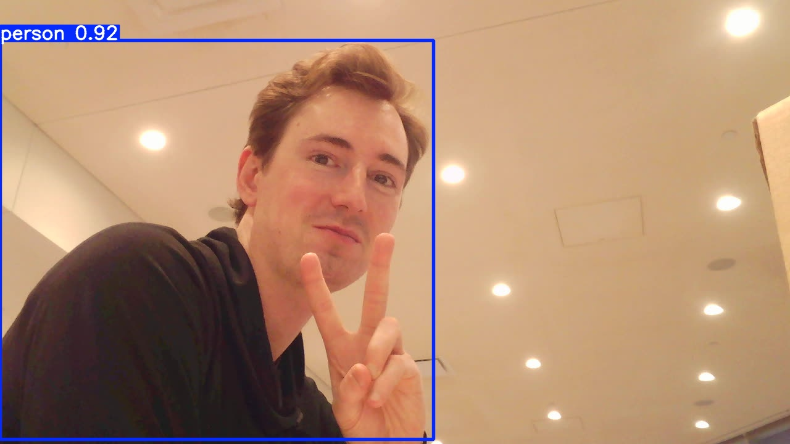
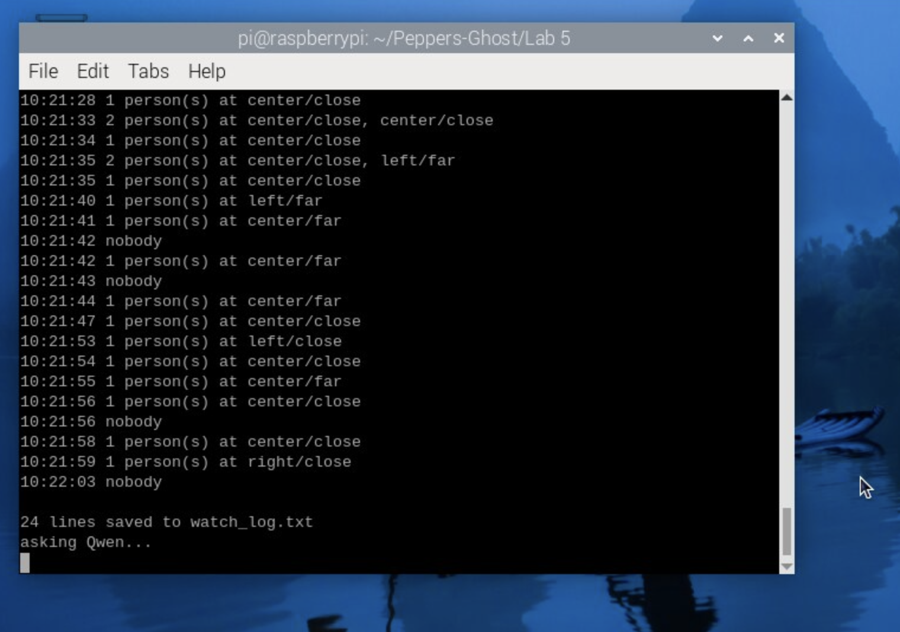
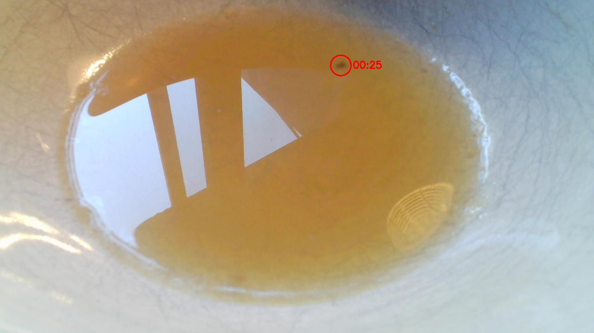
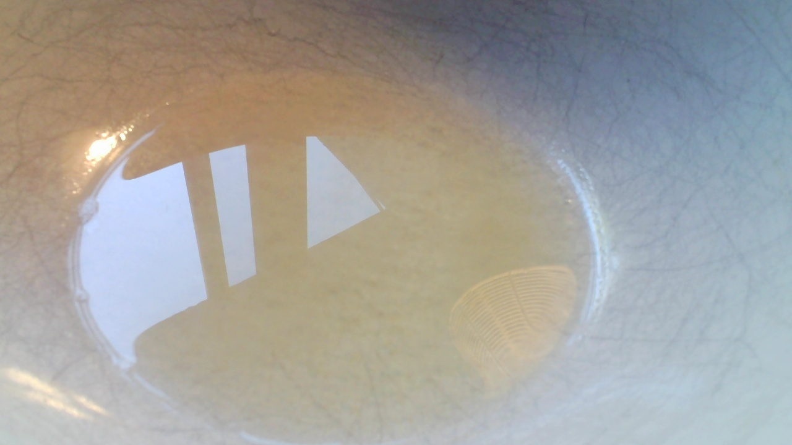

# Observant Systems: Overnight Sensation

**Max Corkran**

For lab this week, we focus on creating interactive systems that can detect and respond to events or stimuli in the environment of the Pi, like the Boat Detector we mentioned in lecture. 
Your **observant device** could, for example, count items, find objects, recognize an event or continuously monitor a room.

This lab will help you think through the design of observant systems, particularly corner cases that the algorithms need to be aware of.

**New this year: the AI runs on the Pi.** Your Pi 5 can run an object detector ([YOLO](https://docs.ultralytics.com/)) and a small language model ([Qwen](https://ollama.com/library/qwen3.5) through [Ollama](https://ollama.com)) completely offline. In Part 1 you get both running and connect them: YOLO *sees*, Qwen *reasons* about what was seen. These models are slow, but they have all night. In Part 2 you use them to design a **night-time interaction**: what you tell the device before bed, what it does while you sleep, and what it shows you when you wake up.

**Collaborators and influences:** Claude (Anthropic's AI assistant, via Claude Code) helped set up the Pi, wrote the bug counter's capture and counting scripts with me, and drafted parts of this writeup from my results.

## Overview

**Part 1: the tools**

A) [Set up your Pi for on-device AI](#part-a)

B) [See: recognize people in real time with YOLO](#part-b)

C) [See more: hands and pose with MediaPipe](#part-c)

D) [Reason: run Qwen on the Pi with Ollama](#part-d)

E) [Connect: from YOLO readings to Qwen reasoning](#part-e)

**Part 2: Overnight Sensation**

F) [Read Part 2 and storyboard your night-time interaction](#part-f)

G) [Design the interaction before bed](#part-g)

H) [Incorporate the observant system during sleep](#part-h)

I) [Design the interaction when awake](#part-i)

The tools from earlier versions of this lab (MobileNet, Teachable Machine, Moondream, audio analysis, classic OpenCV) live in the [legacy folder](legacy/README.md). They are optional, but any of them can be the sensor in your Part 2 system.


## Prep for Part 1

Please check the instructions in [prep.md](prep.md) and complete them before lab. The installs in Part A take a while, so prep.md also tells you how to get a head start.

## The Report

This readme.md page in your own repository should be edited to include the work you have done. You can delete everything but the headers and the sections between the \*\*\***stars**\*\*\*. Write the answers to the questions under the starred sentences. Include any material that explains what you did in this lab hub folder, and link it in the readme.

---

# Part 1

## Part A. Set up your Pi for on-device AI

Everything from Part A is installed on a Pi 5 (8 GB): a Python venv with the requirements, YOLO26-nano exported to NCNN, and Ollama with both Qwen models.

```
NAME            ID              SIZE      MODIFIED
qwen3:0.6b      7df6b6e09427    522 MB    36 seconds ago
qwen3.5:0.8b    de63045f2975    1.3 GB    About a minute ago
```

(`ollama list`, saved in [part-a/ollama_list.txt](part-a/ollama_list.txt).)

YOLO on the test image found 4 people and the bus in 137 ms, and on my own snapshot found me at 0.92 confidence in 66 ms:

 

Setup notes for anyone else doing this:
* On aarch64, `pip install ultralytics` pulls the CUDA build of torch, which downloads several GB of NVIDIA libraries the Pi can't use. Installing the CPU wheels first (`--index-url https://download.pytorch.org/whl/cpu`) avoids it.
* Campus wifi gave the Pi ~100–200 KB/s, so Qwen alone would have taken hours. Downloading big wheels on my laptop and `scp`-ing them to the Pi was about 10x faster; the rest finished at home.
* Ollama's installer tried to pull the models before its own service had started; rerunning `ollama pull` fixed it.
* `yolo predict ... project=runs` still wrote to `runs/detect/runs/...` at the top of the repo with this version of ultralytics.


## Part B. See: recognize people in real time with YOLO

* [Person detection video](media/partB-person-detection.mp4)
* [All 80 classes (`--all`) video](media/partB-all-classes.mp4)

**People-only detection:** YOLO found me at 0.85 when my face and shoulders were in frame. More interesting was what it did *not* call a person: I held up a framed line drawing of a saxophonist and a drummer, two clearly human figures, and it reported 0 objects the whole time. A blurry hand on its own, on the other hand, came up as `person 0.52`. So "person" really means "photo-like body parts", not "anything shaped like a human", which is good for not counting posters and bad if a sleeve or hand is all that's in view.

**`--all`:** pointed at my desk, it got the obvious things right (the desk as `dining table 0.66`, a plate of food as `bowl 0.64`, my arm and sleeve as `person 0.86`) and invented the rest from the closest COCO class it knows: a white holder with red light bulbs became `cup 0.64`, a red bulb on its own became `apple 0.47`, and a pen became `knife 0.51`. The floor, plants and paperwork got nothing. It only knows 80 classes and will always pick one of them.

**`--conf 0.2` / `--conf 0.7`:** didn't make a visible difference in my setup, since the detections I got were mostly either clearly above 0.7 or not there at all.


## Part C. See more: hands and pose with MediaPipe

[Hand pose video](media/partC-hand-pose.mp4)

The hand tracker ran at 6–11 FPS. Pinch-to-volume followed the thumb–index distance (green dot), and Quiet Coyote was recognized reliably and dropped the volume to 0%. It held up even with my hand partly in front of my face. The Pi has no speaker, so the music played silently, but the on-screen meter shows the effect.

**How I'd use pose tracking:** my observant system watches a fruit fly trap (Part 2), so the camera isn't pointed at people at night. Where a hand gesture fits is the *hand-off*: a Quiet Coyote at the camera before bed as the "start watching tonight" signal, and the same gesture in the morning as "show me the report". It's a rule over 21 landmark points, the same way `interpret()` in Part E is a rule over YOLO's boxes, and it needs no button or microphone on the Pi.


## Part D. Reason: run Qwen on the Pi with Ollama

Full output in [part-d-qwen.txt](part-d-qwen.txt).

<details>
<summary>Questions, answers and timings</summary>

**1. "Tell me a bit about the history of Roosevelt Island."** (qwen3.5:0.8b, 32.6 s)
> Roosevelt Island is a historic island in Manhattan, originally built as a military fortification during World War II to protect the harbor from German submarines. It was later converted into an art museum and now serves as a popular tourist destination featuring the famous "Roosevelt Island Ferry," which connects New York City with Queens.

**Same question with qwen3:0.6b** (12.0 s)
> Roosevelt Island, located in the state of New York, was established in 1854 as a temporary refuge for the New York Immigration Board. It was a crucial location for immigrants seeking a stable home and became a significant hub for the community. Today, it remains a symbol of the resilience and diversity of the New York community.

**2. "What is in this photo?"** with `--image snap.jpg` (qwen3.5:0.8b, 119.5 s)
> A man with reddish-brown hair and a black hoodie is making a peace sign against a white ceiling with recessed lights.

**3. "How can I tell a fruit fly from a house fly, and what attracts fruit flies to a kitchen?"** (qwen3.5:0.8b, 14.4 s)
> 1. Fruit flies have long, thin bodies with six legs, while house flies are rounder with eight legs.
> 2. Fruit flies are attracted to sweet food like honey or nectar, whereas house flies seek out human waste for their larvae.
> 3. Fruit flies are often found near fruit and flowers, but house flies prefer warm, dry areas like kitchens.

</details>

**What I took from it:** neither model got a single checkable fact about Roosevelt Island right (Blackwell's Island, Welfare Island, renamed in 1973, Cornell Tech in 2017). The 0.8B model invented a WWII fort and an art museum; the 0.6B model was almost 3x faster and invented a different history. The fly answer is confidently wrong too (house flies have six legs, like every insect). The one good answer was the photo: an accurate description of what was actually in front of it, but it took two minutes.

So the small model is reasonable at describing data you hand it and unreliable at knowing things. That shaped Part 2: Qwen never decides whether there's a fly, it only puts the counter's numbers into words.


## Part E. Connect: from YOLO readings to Qwen reasoning



Log: [part-e-watch_log.txt](part-e-watch_log.txt)

I was the only person in the room for the whole minute. The log has 24 lines anyway, and Qwen concluded there had been **14 distinct individuals**.

The log explains why. YOLO flickers: in under a second the reading goes `center/close` → `center/far` → `center/close`, it drops to `nobody` mid-sequence (10:21:42, 10:21:56), and twice it briefly saw `2 person(s)` (10:21:33, 10:21:35). Every flicker is a new line, and nothing in the interpreter says "the same person as before", only how many and where. From Qwen's side, two dozen lines about a person could easily mean a dozen people.

This is the README's point that the interpreter decides everything the model can know. Two fixes:
* **Debounce the interpreter:** only log a new reading once it has held for a couple of seconds, so flicker never reaches the log.
* **Ask questions the log can answer:** "how many times did the room go empty?" instead of "how many people?"

My Part 2 counter does the first one: a dark spot only counts as a fly once it has stayed for 10 minutes, and both nights' false alarms (shifting reflections) were exactly this kind of flicker.

---

# Lab 5 Part 2: Overnight Sensation — the Fly Trap Night Shift

There are fruit flies in my kitchen. The device is a vinegar trap with a camera over it: I hand it the night before bed, it watches the trap while I sleep, and in the morning it tells me how many flies it caught and when.

* **Sense all night:** a webcam looks straight down at a shallow white dish of apple cider vinegar and dish soap under a lamp that stays on, one frame every 5 seconds.
* **Process in the morning:** [`count.py`](bug-counter/count.py) goes through the ~7,000 frames and finds flies that landed and stayed, and Qwen turns the count into a short report.

Code is in [`bug-counter/`](bug-counter/): [`bedtime.py`](bug-counter/bedtime.py) (hand-off), [`capture.py`](bug-counter/capture.py) (night shift), [`count.py`](bug-counter/count.py) (detector + interpreter), [`report.py`](bug-counter/report.py) (reasoner + reveal).

## Part F. Storyboard

> **TODO (Max): storyboard image here.** Three panels:
> 1. **Before bed:** standing at the counter, holding a "quiet spider" (open hand, fingers spread like legs) over the trap. The Pi's green light blinks three times and goes dark.
> 2. **While asleep:** dark apartment, one lamp on over the dish, the camera looking down; a fruit fly lands on the vinegar at 00:25.
> 3. **When awake:** coffee in hand, reading "Caught 1 fly last night, at 12:25am."

**Why a fly trap:** the question has a real answer I can check by looking in the dish in the morning, so I can tell when the device is wrong. It also keeps the camera pointed at a bowl, not at people.

**Bellotti et al.'s five questions:**
* **Address:** how do I tell it to start? A quiet spider held over the trap, the one thing the top-down camera can see.
* **Attention:** how do I know it's listening? The green LED blinks three times, then goes dark: it's asleep and watching.
* **Action:** what does it do? It takes a frame every 5 seconds all night; it never acts on the room.
* **Alignment:** how do I know it did the right thing? The morning report gives the count and times, and I can look in the dish. The annotated image circles each fly with the time it arrived.
* **Accident:** what if it's wrong? The counter is designed to under-claim: it only counts a spot that stays 10 minutes, it reports anything that appears after dawn as "unsure" rather than a catch, it separates flies already floating at bedtime, and it says if the lamp went off.

## Prep for Part 2

> **TODO (Max): feedback from classmates on the storyboard.**

**Where it spends the night:** the kitchen counter. The camera only sees the dish.

**What changed after the pilot nights and Part E:** see the iterations under Part H. The big one: everything that went wrong was a reflection that shifted (the lamp at first, the window at dawn), the same flicker problem as Part E's "14 people".

> **TODO (Max): revised storyboard, if the feedback changes it.**

## Part G. The interaction before: the quiet spider

Before bed I refresh the trap (fresh vinegar, a drop of soap, skim out anything floating) and hold a **quiet spider** over it: an open hand, all five fingers straight and spread wide, like a spider over its web. [`bedtime.py`](bug-counter/bedtime.py) watches for it with MediaPipe, from above:

* A rule over the 21 hand landmarks: every finger straight (tip farther from the wrist than its middle joint), the thumb out, and every pair of neighbouring fingertips spread apart, all scaled by the size of the palm so it works at any height.
* It has to be held for 1.5 seconds. That's Part E's lesson: one frame is a flicker, not a decision.
* **Acknowledgement:** the Pi's green LED blinks three times slowly and then stays dark for the night, an LED that dims rather than lights up.
* It then waits until no hand has been in view for 30 seconds before the first frame, so my hand (and the ripples) are never in the start-of-night reference the counter compares against.

Quiet Coyote from Part C was the starting point; a spider fits a fly trap, and an open hand is easy to see from directly above.

> **TODO (Max): short video of the hand-off.**

## Part H. The night shift

[`capture.py`](bug-counter/capture.py) takes a 1280×720 frame every 5 seconds and logs each frame's brightness to `capture_log.jsonl`. It runs in `tmux`; the frames stay on the Pi and are not committed.

**Two real nights:**

| | Night 1 (Oct 21–22) | Night 2 (Oct 22–23) |
|---|---|---|
| Recorded | 22:05 – 09:12, 7,806 frames, no gaps | 23:15 – 09:26, 7,152 frames |
| Counter says | **1 caught, arrived 00:25** | **0 caught** |
| In the dish in the morning | 1 fruit fly | none |
| Result |  |  |

Logs and counts: [night 1](bug-counter/results/night1/), [night 2](bug-counter/results/night2/).

Night 1's fly landed at the edge of the liquid at 00:25, struggled for a few minutes, sat there for about four hours, then drifted to where I found it between 04:20 and 05:20.

**How the counter works and how it got there.** Each fix came from checking the counter against what was actually in the frames and the dish:

1. **Find the liquid** in the first frame, so nothing on the dish counts. First by saturation (amber), then switched to **yellowness (Lab b\*)** after night 2: fresh vinegar was much paler and the lamp made the white dish look peachy, so "most saturated" picked the dish.
2. **Find dark spots** with a black-hat filter, which compares each pixel to its neighbourhood, so dawn brightening the whole dish isn't a fly. Bright glare and a ring around it are skipped.
3. **Track spots over time:** a spot that stays 10+ minutes is a catch.
   * The first version said the fly arrived at 00:31, not 00:25: it was ignoring a band along the rim, where the fly landed, and a struggling fly broke its track. Narrower rim margin + tracks that follow a spot further fixed it.
   * Spots already there in the first two minutes are reported as **already in the trap**, not caught.
4. **Daylight:** once the window starts reflecting in the liquid, its edges look like flies. Night 1 got a fake "catch" at 07:24 and night 2 got **four** between 07:10 and 07:34. Anything that appears after dawn is now "unsure", not caught. Dawn detection also needed two tries: "brighter for 10 minutes straight" missed a cloudy dawn that flickered, so it's now "the next 5 minutes are brighter on average than at bedtime".

**Still not handled:** I haven't verified the brief "visits" (spots that come and go). Night 2 has 13 before dawn; they could be flies touching down or camera noise, so the morning report leaves them out. And two nights with one fly is not much data.

> **TODO (Max): photo/video of the setup in the kitchen at night (camera over the dish, lamp).**

## Part I. The interaction after: the morning report

[`report.py`](bug-counter/report.py) runs the counter, then hands Qwen **only the finished numbers** and asks for three sentences. Part D showed the model invents facts and Part E showed it turns a jittery log into "14 people", so it never decides whether there was a fly. The facts line is printed above the report so the two can be compared, and a night with no catches gets a plain sentence without asking the model at all.

**Night 2 (quiet night, no model):**
```
Watched 23:15-09:26. Caught 0. Already in the trap at bedtime: 0. Lamp off: 0 min. Daylight from 07:04.

Quiet night: the trap watched from 23:15 to 09:26 and caught no flies.
```

**Night 1:**
> **TODO (Max): on the Pi, `cd bug-counter/night1 && ../../.venv/bin/python ../report.py`, and paste the output.**

## Final documentation

* **Looks like:** > **TODO (Max): photos/video of the setup.**
* **Works like:** frame every 5 s → liquid mask + dark-spot detector → tracker (catch / visit / already there / unsure) → `count_result.json` → Qwen → three sentences. Two real nights above.
* **Acts like:** quiet spider and a blinking LED before bed; a count you can check against the dish in the morning.

> **TODO (Max): link a short video of the whole system** (YouTube/Drive link is fine).

Privacy: the camera only sees the dish, and the night frames stay on the Pi and get deleted after the demo.
