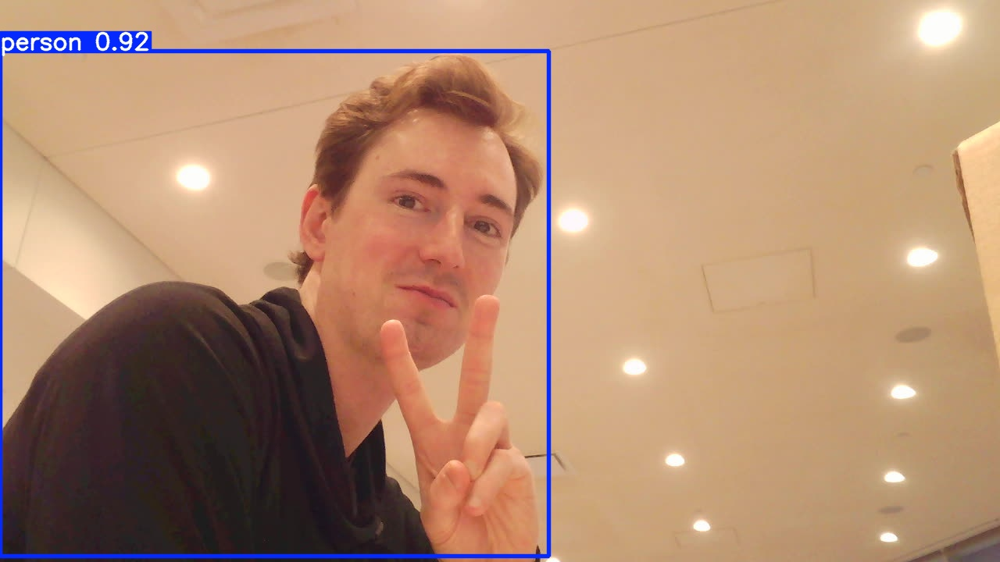
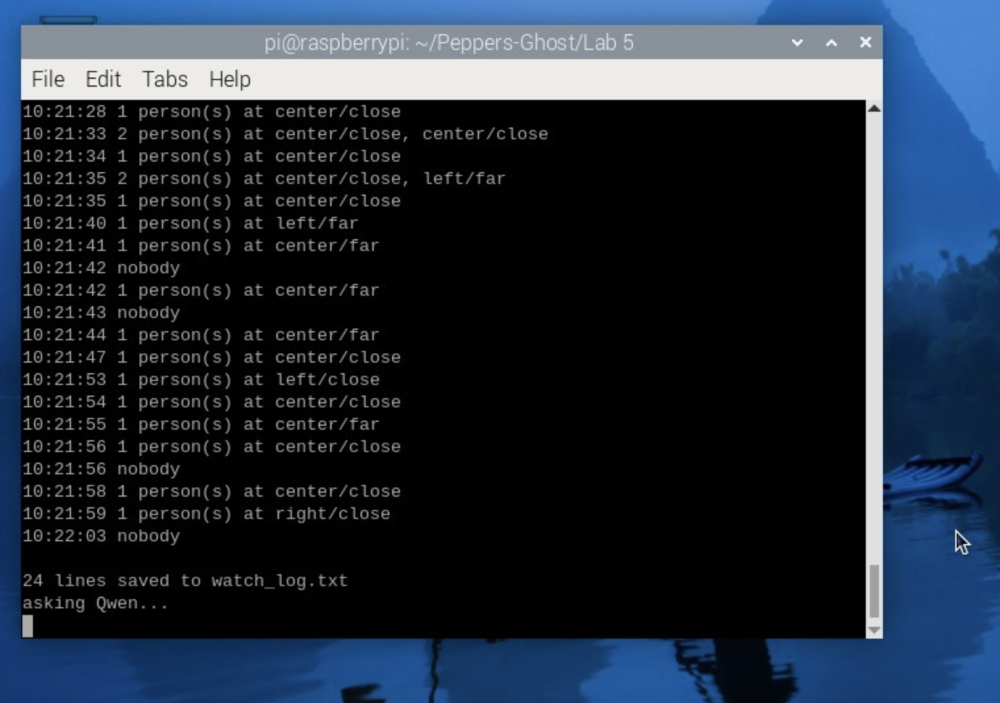

# Observant Systems: Overnight Sensation

Team members: Xie Li (xl2323), Matthias Corkran (mc3223), Yuxuan Wang (yw2946) 

For lab this week, we focus on creating interactive systems that can detect and respond to events or stimuli in the environment of the Pi, like the Boat Detector we mentioned in lecture. 
Your **observant device** could, for example, count items, find objects, recognize an event or continuously monitor a room.

This lab will help you think through the design of observant systems, particularly corner cases that the algorithms need to be aware of.

**New this year: the AI runs on the Pi.** Your Pi 5 can run an object detector ([YOLO](https://docs.ultralytics.com/)) and a small language model ([Qwen](https://ollama.com/library/qwen3.5) through [Ollama](https://ollama.com)) completely offline. In Part 1 you get both running and connect them: YOLO *sees*, Qwen *reasons* about what was seen. These models are slow, but they have all night. In Part 2 you use them to design a **night-time interaction**: what you tell the device before bed, what it does while you sleep, and what it shows you when you wake up.

**Please indicate anyone you collaborated with on this Lab here.**
Be generous in acknowledging their contributions! And also recognizing any other influences (e.g. from YouTube, Github, Twitter) that informed your design. 

Matthias (mc3223) used Claude (Anthropic's AI assistant, via Claude Code) to help set up the Pi, write the bug counter's capture, counting, bedtime and report scripts, and draft his sections of this writeup from his results.

## Overview

**Part 1: the tools**

A) [Set up your Pi for on-device AI](#part-a)

B) [See: recognize people in real time with YOLO](#part-b)

C) [See more: hands and pose with MediaPipe](#part-c)

D) [Reason: run Qwen on the Pi with Ollama](#part-d)

E) [Connect: from YOLO readings to Qwen reasoning](#part-e)

**Part 2: Overnight Sensation**

F) [Read Part 2 and storyboard your night-time interaction](#part-f)

G) [Design the interaction before bed](#part-g)

H) [Incorporate the observant system during sleep](#part-h)

I) [Design the interaction when awake](#part-i)

The tools from earlier versions of this lab (MobileNet, Teachable Machine, Moondream, audio analysis, classic OpenCV) live in the [legacy folder](legacy/README.md). They are optional, but any of them can be the sensor in your Part 2 system.


## Prep for Part 1

Please check the instructions in [prep.md](prep.md) and complete them before lab. The installs in Part A take a while, so prep.md also tells you how to get a head start.

## The Report

This readme.md page in your own repository should be edited to include the work you have done. You can delete everything but the headers and the sections between the \*\*\***stars**\*\*\*. Write the answers to the questions under the starred sentences. Include any material that explains what you did in this lab hub folder, and link it in the readme.

---

# Part 1

## Part A. 
### Set up your Pi for on-device AI

Create a virtual environment and install the requirements. They include `ultralytics` (YOLO), which pulls in torch, so this takes a while:

```
pi@raspberrypi:~$ cd Interactive-Lab-Hub/Lab\ 5
pi@raspberrypi:~/Interactive-Lab-Hub/Lab 5 $ python3 -m venv .venv
pi@raspberrypi:~/Interactive-Lab-Hub/Lab 5 $ source .venv/bin/activate
(.venv) pi@raspberrypi:~/Interactive-Lab-Hub/Lab 5 $ pip install -r requirements.txt
```

As in Lab 3, [`uv`](https://docs.astral.sh/uv/) is a much faster drop-in for `pip`: `pip install uv && uv pip install -r requirements.txt`.

### YOLO: download the nano model and export it for the Pi

We use the nano model of [YOLO26](https://docs.ultralytics.com/models/yolo26/), exported once to NCNN, the format that runs fastest on the Pi. This downloads the weights, so you need internet:

```
(.venv) pi@raspberrypi:~/Interactive-Lab-Hub/Lab 5 $ python -c "from ultralytics import YOLO; YOLO('yolo26n.pt').export(format='ncnn')"
```

Test it on an image from the internet. `project=runs` keeps the output in this folder; without it, ultralytics writes to a `runs/` folder at the top of your git repo, where you will not think to look.

```
(.venv) pi@raspberrypi:~/Interactive-Lab-Hub/Lab 5 $ yolo predict model=yolo26n_ncnn_model source=https://ultralytics.com/images/bus.jpg project=runs
```

The result is in `runs/predict/bus.jpg`: boxes around the people and the bus.

Now a photo of your own. Plug in the webcam and take one with `snap.py` (`--delay 3` gives you three seconds to get into the frame), or copy a photo from your phone to the Pi with `scp`. Then run the same command on it:

```
(.venv) pi@raspberrypi:~/Interactive-Lab-Hub/Lab 5 $ python snap.py --delay 3
(.venv) pi@raspberrypi:~/Interactive-Lab-Hub/Lab 5 $ yolo predict model=yolo26n_ncnn_model source=snap.jpg project=runs
```

Every run gets its own numbered folder, so this one is in `runs/predict2/snap.jpg`; the command prints where it saved. Keep `snap.jpg`, you will show it to Qwen in Part D.

### Ollama: install it and pull Qwen

[Ollama](https://ollama.com) runs language models locally. Nothing leaves the Pi: no API key, no internet after the download.

```
pi@raspberrypi:~ $ curl -fsSL https://ollama.com/install.sh | sh
pi@raspberrypi:~ $ ollama pull qwen3.5:0.8b
pi@raspberrypi:~ $ ollama pull qwen3:0.6b
pi@raspberrypi:~ $ ollama list
```

| model | download | what it does |
|---|---|---|
| `qwen3.5:0.8b` | ~1.3 GB | text **and images**; the one we use in this lab |
| `qwen3:0.6b` | ~0.5 GB | text only, smaller and faster (~16 tokens/s on a Pi 5) |


#### Matthias's run (mc3223)

Everything from Part A is installed on a Pi 5 (8 GB): a Python venv with the requirements, YOLO26-nano exported to NCNN, and Ollama with both Qwen models.

```
NAME            ID              SIZE      MODIFIED
qwen3:0.6b      7df6b6e09427    522 MB    36 seconds ago
qwen3.5:0.8b    de63045f2975    1.3 GB    About a minute ago
```

(`ollama list`, saved in [part-a/ollama_list.txt](part-a/ollama_list.txt).)

YOLO on the test image found 4 people and the bus in 137 ms, and on my own snapshot found me at 0.92 confidence in 66 ms:

 

Setup notes for anyone else doing this:
* On aarch64, `pip install ultralytics` pulls the CUDA build of torch, which downloads several GB of NVIDIA libraries the Pi can't use. Installing the CPU wheels first (`--index-url https://download.pytorch.org/whl/cpu`) avoids it.
* Campus wifi gave the Pi ~100–200 KB/s, so Qwen alone would have taken hours. Downloading big wheels on my laptop and `scp`-ing them to the Pi was about 10x faster; the rest finished at home.
* Ollama's installer tried to pull the models before its own service had started; rerunning `ollama pull` fixed it.
* `yolo predict ... project=runs` still wrote to `runs/detect/runs/...` at the top of the repo with this version of ultralytics.


## Part B. 
### See: recognize people in real time with YOLO

YOLO is an *object detector*: it finds every person, cup, cat and so on (the 80 [COCO](https://cocodataset.org/) classes), draws a box around each, and gives a confidence. For an observant system that is exactly what you want: *how many*, *where*, *how sure*.

Connect your webcam, connect to your Pi through **VNC** (the script opens a window), and run the person detector. Read `yolo_person.py` first; the loop at the bottom is the whole idea.

```
(.venv) pi@raspberrypi:~/Interactive-Lab-Hub/Lab 5 $ python yolo_person.py
```

While it runs, walk in and out of the frame, sit down, turn your back, turn the lights off, hold up a photo of a person on your phone. Watch the confidence number on the box change with each.

Then press q to quit and run it again with a flag. Each one changes a single thing:

```
(.venv) pi@raspberrypi:~/Interactive-Lab-Hub/Lab 5 $ python yolo_person.py --conf 0.2     # lower the bar: see what the model is unsure about
(.venv) pi@raspberrypi:~/Interactive-Lab-Hub/Lab 5 $ python yolo_person.py --conf 0.7     # raise the bar: see what you lose
(.venv) pi@raspberrypi:~/Interactive-Lab-Hub/Lab 5 $ python yolo_person.py --all          # all 80 classes, not only people: what else is on your desk, and what does it get wrong?
(.venv) pi@raspberrypi:~/Interactive-Lab-Hub/Lab 5 $ python yolo_person.py --headless     # no window, only the printed readings: how it runs over ssh, and at night
```

[Watch the Part B person detection demo](media/partB-xie-person-detection.mp4)


In Part B, I tested the default person detection mode, confidence thresholds of 0.2 and 0.7, detection across all classes, and headless mode without a display window.

Person detection was generally reliable. During my tests, I did not observe any instances where I remained in the camera frame but was not detected. However, although I was the only person present throughout the tests, the model sometimes detected my hand as an additional person, causing the reported count to increase to two. This was a confirmed false positive, possibly because the model interpreted the hand’s partial outline as human features.

In all-class detection mode, the model incorrectly labeled my headphones as a “toilet” with a confidence of 0.61 and part of an earcup as a “banana” with a confidence of 0.52. It correctly identified a bottle as “bottle” with a confidence of 0.78. These results show that a relatively high confidence score does not necessarily indicate a correct classification.

So far, I have confirmed one type of false positive in person detection. I have not yet observed two additional situations involving missed or falsely detected people.

#### Matthias's run (mc3223)

* [Person detection video](media/partB-person-detection.mp4)
* [All 80 classes (`--all`) video](media/partB-all-classes.mp4)

**People-only detection:** YOLO found me at 0.85 when my face and shoulders were in frame. More interesting was what it did *not* call a person: I held up a framed line drawing of a saxophonist and a drummer, two clearly human figures, and it reported 0 objects the whole time. A blurry hand on its own, on the other hand, came up as `person 0.52`. So "person" really means "photo-like body parts", not "anything shaped like a human", which is good for not counting posters and bad if a sleeve or hand is all that's in view.

**`--all`:** pointed at my desk, it got the obvious things right (the desk as `dining table 0.66`, a plate of food as `bowl 0.64`, my arm and sleeve as `person 0.86`) and invented the rest from the closest COCO class it knows: a white holder with red light bulbs became `cup 0.64`, a red bulb on its own became `apple 0.47`, and a pen became `knife 0.51`. The floor, plants and paperwork got nothing. It only knows 80 classes and will always pick one of them.

**`--conf 0.2` / `--conf 0.7`:** didn't make a visible difference in my setup, since the detections I got were mostly either clearly above 0.7 or not there at all.


## Part C. 
### See more: hands and pose with MediaPipe

YOLO tells you that a person is there. Google's [MediaPipe](https://mediapipe.dev/) tells you what their hands and body are doing: face, hand and body pose detection, fast on the Pi.


The demo plays a looping audio file, so make the helper script executable first:

```
(.venv) pi@raspberrypi:~/Interactive-Lab-Hub/Lab 5 $ chmod +x loop_audio.sh
```

Connect your webcam, connect to your Pi through **VNC**, and run the hand pose script:
(***it will not work if you use ssh from your laptop***)

```
(.venv) pi@raspberrypi:~/Interactive-Lab-Hub/Lab 5 $ python hand_pose.py
```

Try the two main features of this script: 1) pinching for percentage control (the thumb-to-index distance sets the volume), and 2) "[Quiet Coyote](https://www.youtube.com/watch?v=qsKlNVpY7zg)" for instant percentage setting (the gesture mutes it). Notice how this example uses hardcoded positions and relates those positions with a desired set of events, in `hand_pose.py`: a hand is 21 landmark coordinates, and an *event* is a rule you write over them. That is the same job as `interpret()` in Part E.

Consider how you might use this position based approach to create an interaction, and write how you might use it on either face, hand or body pose tracking.

[Watch the Part C hand gesture demo](media/partC-xie-hand-pose.mp4)

In Part C, I used MediaPipe to track hand landmarks. Changing the distance between my thumb and index finger adjusted the displayed percentage, while the Quiet Coyote gesture set it to 0%.

I could use these gestures in my observant system to start overnight monitoring and silently acknowledge a morning report without touching the device.

#### Matthias's run (mc3223)

[Hand pose video](media/partC-hand-pose.mp4)

The hand tracker ran at 6–11 FPS. Pinch-to-volume followed the thumb–index distance (green dot), and Quiet Coyote was recognized reliably and dropped the volume to 0%. It held up even with my hand partly in front of my face. The Pi has no speaker, so the music played silently, but the on-screen meter shows the effect.

**How I'd use pose tracking:** my observant system watches a fruit fly trap (Part 2), so the camera isn't pointed at people at night. Where a hand gesture fits is the *hand-off*: a Quiet Coyote at the camera before bed as the "start watching tonight" signal, and the same gesture in the morning as "show me the report". It's a rule over 21 landmark points, the same way `interpret()` in Part E is a rule over YOLO's boxes, and it needs no button or microphone on the Pi.

## Part D. 
### Reason: run Qwen on the Pi with Ollama

Talk to the model in the terminal first. Qwen3 models "think" before they answer, which is slow on a Pi, so turn it off. Then ask about something you can check:

```
pi@raspberrypi:~ $ ollama run qwen3.5:0.8b
>>> /set nothink
>>> Tell me a bit about the history of Roosevelt Island. Three sentences.
>>> /bye
```

Roosevelt Island is a good first question because you know the ground truth: it was Blackwell's Island, then Welfare Island, got its current name in 1973, and Cornell Tech opened on it in 2017. Count how many of the model's facts are true.

From Python it is a dozen lines with `requests`; `ask_qwen.py` is that script. It turns thinking off, tells the model to answer in at most three sentences, and cuts it off after 120 tokens (`--max-tokens` changes that), because a small model left alone writes an essay. Read it, then run:

```
(.venv) pi@raspberrypi:~/Interactive-Lab-Hub/Lab 5 $ python ask_qwen.py "Tell me a bit about the history of Roosevelt Island."
(.venv) pi@raspberrypi:~/Interactive-Lab-Hub/Lab 5 $ python ask_qwen.py --model qwen3:0.6b "Tell me a bit about the history of Roosevelt Island."
(.venv) pi@raspberrypi:~/Interactive-Lab-Hub/Lab 5 $ python ask_qwen.py --image snap.jpg "What is in this photo?"
```

Four things in the [Ollama API](https://github.com/ollama/ollama/blob/main/docs/api.md) worth knowing:

* `think: false` skips the reasoning trace. Always, on a Pi. `ask_qwen.py` sends it on every request; `--think` turns the trace back on for one question, so you can see what you are skipping and how long it takes.
* `options.num_predict` is a hard cap on the answer length, in tokens. The model does not know about it, so it may stop mid-sentence; the `system` prompt is what asks it to be brief in the first place. `ask_qwen.py` uses both.
* `format` makes the model answer as JSON with the fields you name (`--json`). Handy when a display or a servo has to read the answer.
* `images` sends a photo along with the prompt (`--image snap.jpg`, the photo from Part A). `qwen3.5:0.8b` can look at pictures.

A 0.8B model is slow and sometimes wrong. It will invent events that are not in the data and agree with a wrong premise. Give it the data, keep its job narrow, and decide what the device does when the model is unsure.


I ran Qwen locally through Ollama with thinking disabled. I tested three bedside questions using this **synthetic log**, rather than real overnight data:

- 23:00 — Nobody present.
- 23:10 — One person entered.
- 23:12 — The person left.

| Question | Qwen3.5:0.8b response summary | Time | Evaluation |
|---|---|---|---|
| Did anyone enter the room after 23:00? | Nobody entered. | 2.6 s | Incorrect: one person entered at 23:10. |
| How many minutes did the person stay in the room? | From 23:00 to 23:12, totaling 22 minutes. | 4.7 s | Incorrect: the recorded stay was 2 minutes. |
| Can you determine whether I slept well that night? | I likely slept well because little activity occurred. | 5.9 s | Unsupported: the log contains no sleep-quality information. |

**Model comparison:** I repeated the first question with `qwen3:0.6b`. It correctly identified the entry at 23:10 and departure at 23:12, taking **5.0 seconds**, compared with **2.6 seconds** for `qwen3.5:0.8b`. In this trial, the smaller model was slower but more accurate.

These tests showed that even answers based on explicit logs require verification.

#### Matthias's run (mc3223)

Full output in [part-d-qwen.txt](part-d-qwen.txt).

<details>
<summary>Questions, answers and timings</summary>

**1. "Tell me a bit about the history of Roosevelt Island."** (qwen3.5:0.8b, 32.6 s)
> Roosevelt Island is a historic island in Manhattan, originally built as a military fortification during World War II to protect the harbor from German submarines. It was later converted into an art museum and now serves as a popular tourist destination featuring the famous "Roosevelt Island Ferry," which connects New York City with Queens.

**Same question with qwen3:0.6b** (12.0 s)
> Roosevelt Island, located in the state of New York, was established in 1854 as a temporary refuge for the New York Immigration Board. It was a crucial location for immigrants seeking a stable home and became a significant hub for the community. Today, it remains a symbol of the resilience and diversity of the New York community.

**2. "What is in this photo?"** with `--image snap.jpg` (qwen3.5:0.8b, 119.5 s)
> A man with reddish-brown hair and a black hoodie is making a peace sign against a white ceiling with recessed lights.

**3. "How can I tell a fruit fly from a house fly, and what attracts fruit flies to a kitchen?"** (qwen3.5:0.8b, 14.4 s)
> 1. Fruit flies have long, thin bodies with six legs, while house flies are rounder with eight legs.
> 2. Fruit flies are attracted to sweet food like honey or nectar, whereas house flies seek out human waste for their larvae.
> 3. Fruit flies are often found near fruit and flowers, but house flies prefer warm, dry areas like kitchens.

</details>

**What I took from it:** neither model got a single checkable fact about Roosevelt Island right (Blackwell's Island, Welfare Island, renamed in 1973, Cornell Tech in 2017). The 0.8B model invented a WWII fort and an art museum; the 0.6B model was almost 3x faster and invented a different history. The fly answer is confidently wrong too (house flies have six legs, like every insect). The one good answer was the photo: an accurate description of what was actually in front of it, but it took two minutes.

So the small model is reasonable at describing data you hand it and unreliable at knowing things. That shaped Part 2: Qwen never decides whether there's a fly, it only puts the counter's numbers into words.


## Part E. 
### Connect: from YOLO readings to Qwen reasoning

An observant system is a pipeline: a **detector** turns pixels into boxes, an **interpreter** turns boxes into readings in words ("one person, left, close"), the readings pile up in a **log**, and a **reasoner** answers a question about the log. The language model never sees pixels, only the words you chose in the interpreter. That makes the interpreter the most important design decision in the system.

`yolo_to_qwen.py` is the pipeline in one file, one function per stage. Read it before you run it:

* `interpret(r)` is the interpreter. It takes one YOLO result and returns one reading. A person is *left*, *center* or *right* by which third of the frame the middle of their box is in, and *close* if the box is taller than 60% of the frame, *far* otherwise. The reading is a string like `1 person(s) at center/close`, or `nobody`. Fifteen lines, and they decide everything the model can know.
* `watch(seconds)` is the detector and the log. Twice a second it reads a frame, runs YOLO on it and calls `interpret()`. A time-stamped reading goes into the log **only when it differs from the previous one**, so a minute of sitting still is one line, not 120.
* `ask(log, question)` is the reasoner. It pastes the log and your question into one prompt, tells Qwen to answer in at most three sentences using only what is in the log, and sends it to Ollama with thinking off.

Run it through VNC and a window opens with YOLO's boxes, the current reading and the seconds left. Press q to stop watching early. Over plain ssh add `--headless` and you get the same thing minus the window.

```
(.venv) pi@raspberrypi:~/Interactive-Lab-Hub/Lab 5 $ python yolo_to_qwen.py
```

It watches for a minute, saves the log to `watch_log.txt` and asks Qwen the default question. The terminal looks something like this:

```
14:02:11 nobody
14:02:19 1 person(s) at right/far
14:02:24 1 person(s) at center/close
14:02:51 nobody

4 lines saved to watch_log.txt
asking Qwen...

Qwen (18.4 s):
One person came in from the right, moved close to the camera, and left after about half a minute. ...
```

Those four lines are the whole of what Qwen knows about the minute. If YOLO lost you for one frame, the log says you left and came back, and the report will say so too.

Run it with a partner: have them walk in, sit down, leave. Compare the log with what Qwen concluded. Then change one thing at a time:

* **The question.** `--question "Did anyone leave?"`, `--question "Should I be worried?"`, `--question "Write one sentence a sleepy person would want to hear."` Same log, different job for the reasoner.
* **The interpreter.** Edit `interpret()`: drop the positions, add "standing" versus "sitting" (a sitting person's box is shorter and squarer), count only people who are close. Qwen's answers change because its world changed.
* **The other objects.** By default the detector is told to look for people only. With `--all` it reports all 80 classes and the interpreter adds them to the reading, as in `1 person(s) at center/close; also chair, cup`. Look closely at what it names: at 320 pixels a white chair, a bucket or a sink is a "toilet" often enough, and Qwen will faithfully report the toilet in your bedroom. Deciding which objects deserve a mention is interpreter work.
* **The log.** Every run saves `watch_log.txt`. Edit it so it contradicts itself and feed it back with `--log watch_log.txt`: the camera is skipped and Qwen reasons over your edited file. Does it notice?
* **The format.** `--json` gets `{"people": 1, "activity": "...", "unusual": false}` back, which is what you will want in Part 2 to drive a display or a sound.
* **The timing.** `--seconds 300` watches longer. `--every` logs every reading instead of only changes, so the log grows to hundreds of lines and Qwen has to find the changes itself. See whether it still can.


I tested the YOLO-to-Qwen pipeline three times using recorded detection logs.
In Run 1 (11.0 s), Qwen incorrectly reported continuous presence and no movement; in Run 2 (15.7 s), it incorrectly answered that nobody left.
For Run 3, I simplified `interpret()` to output explicit person counts without positions, aiming to reduce confusion.
Despite the clearer 0 → 1 → 0 log, Qwen again claimed nobody left (11.7 s).
These tests showed that simplifying the interpreter did not resolve the model’s reasoning errors.

#### Matthias's run (mc3223)



Log: [part-e-watch_log.txt](part-e-watch_log.txt)

I was the only person in the room for the whole minute. The log has 24 lines anyway, and Qwen concluded there had been **14 distinct individuals**.

The log explains why. YOLO flickers: in under a second the reading goes `center/close` → `center/far` → `center/close`, it drops to `nobody` mid-sequence (10:21:42, 10:21:56), and twice it briefly saw `2 person(s)` (10:21:33, 10:21:35). Every flicker is a new line, and nothing in the interpreter says "the same person as before", only how many and where. From Qwen's side, two dozen lines about a person could easily mean a dozen people.

This is the README's point that the interpreter decides everything the model can know. Two fixes:
* **Debounce the interpreter:** only log a new reading once it has held for a couple of seconds, so flicker never reaches the log.
* **Ask questions the log can answer:** "how many times did the room go empty?" instead of "how many people?"

My Part 2 counter does the first one: a dark spot only counts as a fly once it has stayed for 10 minutes, and both nights' false alarms (shifting reflections) were exactly this kind of flicker.

---

# Lab 5 Part 2: Overnight Sensation

For Part 2, you will use the observant system from Part 1 to design a night-time interaction. On-device AI is slow, so let it work while you sleep. The person meets the device twice: **before bed**, when they hand the night over, and **when awake**, when the device gives something back. In between, the pipeline from Part E runs on its own.

Two flavors, pick one or mix them:

* **Sense all night.** The Pi watches, listens or measures from bedtime until morning and keeps a log.
* **Process all night.** You already have the data (a day of phone photos, a long recording) and the Pi needs hours to get through it.

Two house rules. Sample rather than stream: one look every 5 to 30 seconds is plenty, and it keeps the Pi cool. And keep everything on the Pi: tell the people you live with, point the camera at things rather than at beds, and delete the snapshots after the demo.

## Part F. 
### Read Part 2 and storyboard your night-time interaction

Storyboard a night-time interaction built on your observant system, in three panels:

1. **Before bed.** How does the person hand the night over, and how does the device acknowledge it?
2. **While asleep.** What does the device watch or work through?
3. **When awake.** What is the one thing the person learns, and in what medium?

Stuck? A kitchen that tells you who raided the fridge. A desk that reports whether you actually went to bed. A window that names the quietest hour. A plant that describes its night. Find something better.

Use storyboards and/or [Verplank diagrams](https://ccrma.stanford.edu/courses/250a-fall-2004/IDSketchbok.pdf).


Our night-time interaction has three stages:

- **Before bed:** The user holds an open hand with all five fingers spread—the “quiet spider” gesture—over the trap. The Pi’s green LED blinks three times and then goes dark to acknowledge the hand-off.

- **While asleep:** The camera watches the vinegar trap, capturing one image approximately every five seconds. The images stay on the Pi for processing. The storyboard above illustrates a fly approaching the bowl and being observed after entering it.

- **When awake:** The system processes the recorded images and presents a short morning report in the terminal. The user learns how many flies were caught and when they arrived, or receives a clear message that no flies were caught.


## Prep for Part 2

1. Look at and give feedback on the Part F storyboards.
   ### Storyboard feedback — simulated peer review

- “Your initial storyboard explains the overall bedtime-to-morning sequence, but the fly’s arrival feels sudden. Could you show it flying into the scene, approaching the bowl, and then entering it? That would make the sequence easier to follow.”

- “The wide view shows the equipment clearly, but I cannot tell what the camera is observing inside the bowl. A top-down close-up would help explain where detection happens.”

- “The fly symbol on the screen tells me that something was detected, but it does not show which object the system identified. Adding a box around the fly would make the detection more explicit.”

- “One detection does not explain what happens as the fly moves. Showing the detection box following the same fly across successive panels would communicate the tracking idea more clearly.”
2. [Update your Lab Hub](prep.md#get-the-latest-content) to get the latest content for Part 2.
3. Decide where the device will spend the night and who else lives there. Get their OK before the first run.
4. Revise your storyboard with the feedback and with what you learned in Part E about where the pipeline breaks.


## Part G. 
### Design the interaction before bed

The hand-off: the person tells the device what to watch tonight, and the device acknowledges it. Keep it to a thirty-second ritual. A button or a touch (Lab 4), a spoken sentence (Lab 3), a wave or a Quiet Coyote at the camera (Part C). The acknowledgement can be a line on the display, a tone, or an LED that dims rather than lights up. At its simplest, the hand-off just sets the question that the morning will answer.

\*\*\***Describe the bedtime interaction and include a short video of someone handing the night over to the device.**\*\*\*

Our bedtime interaction hands the device one question: **“How many flies will the trap catch tonight, and when will they arrive?”**

Before bed, the user prepares the vinegar trap and holds an open hand with all five fingers spread—the **“quiet spider”** gesture—over the bowl, within the camera’s view.

The device is designed to recognise the gesture after it has been held for approximately 1.5 seconds. The Pi’s green LED then blinks three times and goes dark, acknowledging the hand-off without leaving a bright light on overnight.

After the hand leaves the frame and the liquid has time to settle, the camera begins capturing an image approximately every five seconds. The user can leave the device to record overnight; the images remain on the Pi for morning processing.

[Watch the bedtime interaction video](media/setup.mp4)

The video shows the physical setup and a demonstration of the open-hand gesture above the trap.

## Part H. 
### Incorporate the observant system during sleep

The Part E pipeline becomes the night shift. `overnight.py` runs your `interpret()` from `yolo_to_qwen.py` every few seconds, people only unless you pass `--all`, and writes the readings to `night_log.jsonl`; the reasoning waits for the morning. Start it inside `tmux` so it keeps running after you close your laptop, and stop it with Ctrl-C in the morning:

```
(.venv) pi@raspberrypi:~/Interactive-Lab-Hub/Lab 5 $ tmux new -s night
(.venv) pi@raspberrypi:~/Interactive-Lab-Hub/Lab 5 $ python overnight.py
```

Fake a night first: run it for thirty seconds while you walk around, stop it, and run `morning.py` from Part I. When that looks right, run a real night. If your storyboard needs a sensor rather than the camera, swap in the Lab 4 example code and log its reading the same way.

Our group used a custom fly-trap pipeline instead of the default person detector. A webcam pointed down at the vinegar trap and captured a 1280 × 720 image approximately every five seconds. The capture process ran inside `tmux` so it could continue after the laptop disconnected.

The images stayed on the Pi. Each image also produced a timestamped entry in `capture_log.jsonl`, recording its filename and average brightness. In the morning, `count.py` processed the images to identify and track dark spots within the liquid.

### Real overnight runs

The following recordings and original results were collected by our teammate, mc3223.

| | Night 1 | Night 2 |
|---|---|---|
| Date | October 21–22, 2026 | October 22–23, 2026 |
| Recording period | 22:05–09:12 | 23:15–09:26 |
| Frames recorded | 7,806 | 7,152 |
| Reported catches | 1, arriving at 00:25 | 0 |
| Teammate's morning inspection | 1 fruit fly | No flies |

- [Night 1 capture log](bug-counter/results/night1/capture_log.jsonl)
- [Night 1 results and annotated image](bug-counter/results/night1)
- [Night 2 capture log](bug-counter/results/night2/capture_log.jsonl)
- [Night 2 results and annotated image](bug-counter/results/night2)
- [Capture and counting code](bug-counter)

### What broke or surprised us

**Reflections could look like flies.** The lamp and the window at dawn created dark edges in the liquid that produced false detections. The counter excludes bright glare and classifies new persistent spots appearing after daylight as uncertain rather than confirmed catches.

**A single detection was not enough.** A newly landed fly could struggle or drift, interrupting its track. The tracking rules were adjusted to tolerate short detection gaps and movement. A candidate must persist for at least ten minutes to count as a catch; persistent spots present at the beginning are recorded separately as already in the trap.

**Lighting changed the liquid's appearance.** A saturation-based mask did not work consistently with paler vinegar. The liquid mask was revised to use yellowness in Lab colour space.

The final counts matched our teammate's morning inspections for these two nights. However, two nights with only one confirmed fly provide limited validation. Brief visits remain unverified and are excluded from the morning report.

## Part I. 
### Design the interaction when awake

The reveal. The night produced a log; the morning turns it into something a half-awake person can take in. `morning.py` is the smallest version: it asks Qwen for a three-sentence report.

```
(.venv) pi@raspberrypi:~/Interactive-Lab-Hub/Lab 5 $ python morning.py
```

Make it yours: show the report on the Mini PiTFT, read it aloud with Piper from Lab 3, plot the night as a timeline, or ask for JSON (`--json`, Part D) and move a servo. Whatever you pick, make sure it is honest about a night in which nothing happened.

Our morning interaction is a short report displayed in the terminal. It answers the question handed to the device before bed: **“How many flies were caught last night, and when did they arrive?”**

We use the custom `bug-counter/report.py` script. The image-processing pipeline calculates the counts and arrival times first. The script prints these facts, then asks Qwen to turn them into a brief morning report. Qwen does not decide whether a fly was caught.

This design follows our experience in Part E: the language model could misinterpret detection logs, so its role is limited to summarising the finished measurements.

### A night with no catches

For Night 2, the program uses a fixed message without calling Qwen. The output recorded in our teammate's write-up was:

```text
Watched 23:15-09:26. Caught 0. Already in the trap at bedtime: 0. Lamp off: 0 min. Daylight from 07:04.

Quiet night: the trap watched from 23:15 to 09:26 and caught no flies.
```

This gives the user a clear result even when nothing was caught. If the lamp was off, the script adds a warning that some activity may have been missed.

### Checking the result

The facts line lets the user compare the generated wording with the measured count and times. For a night with catches, an annotated image also marks the counted candidates, which the user can compare with the contents of the bowl.

The counter stores uncertain detections separately. These are not currently included in the morning message, so making that uncertainty visible remains an improvement.

- [Morning report code](bug-counter/report.py)
- [Night 1 count and annotated image](bug-counter/results/night1)
- [Night 2 results](bug-counter/results/night2)

## Final documentation

Document all the prototypes and iterations you have designed and worked on. The deliverables for this lab are writings, sketches, photos, and videos that show what your system:

* "Looks like": how the device sits in the room at night, and what it looks like at bedtime and in the morning.
* "Works like": the pipeline from detector to interpreter to log to reasoner, with a real night's data.
* "Acts like": how a person hands the night over and what they get back.

### Looks like

Our device is a vinegar fly trap monitored by a webcam connected to a Raspberry Pi. The camera is positioned above the bowl, with a lamp providing overnight illumination. Its view is focused on the trap rather than on people.

[Watch the setup and bedtime gesture video](media/setup.mp4)

### Works like

The system captures an image approximately every five seconds and saves a timestamped brightness log. In the morning, the counter identifies dark spots within the liquid and tracks them over time. Persistent candidates are counted separately from brief visits, objects already present at bedtime, and uncertain detections after daylight.

The resulting counts and arrival times are passed to Qwen for a short morning summary. A night with no catches receives a fixed message instead.

Two overnight recordings produced one reported catch on October 21–22 and zero on October 22–23, matching our teammate's morning inspections.

[View the implementation and overnight results](bug-counter)

### Acts like

Before bed, the user performs the “quiet spider” gesture above the trap. The designed acknowledgement is three green LED blinks followed by darkness. After the hand leaves and the liquid settles, overnight recording begins.

In the morning, the user reads the confirmed count and arrival times in the terminal and can inspect the annotated image alongside the physical trap.

### Prototypes and iterations

The reconstructed initial storyboard presents a simple setup–observation–message sequence. The revised storyboard expands the fly's approach, entry into the bowl, detection, and tracking.

Testing also led to changes in the liquid mask, tolerance for interrupted tracks, and handling of daylight reflections. Part E informed the decision to calculate counts before asking Qwen to summarise them.


As always, make sure you document contributions and ideas from others (and AI) explicitly in your writeup.

You are permitted (but not required) to work in groups and share a turn in; you are expected to make equal contribution on any group work you do, and N people's group project should look like N times the work of a single person's lab. Make sure the page for the group turn in is linked to your personal Interactive Lab Hub page.

## Deliverables & Submission for Lab 5

For submission, the readme.md page for this lab should be edited to include the work you have done:
* Upload any materials that explain what you did, including your code and night log, into your Lab 5 repository, and link them in your Lab 5 readme.md.
* Link your Lab 5 readme.md in your main Interactive-Lab-Hub readme.md.
* Labs are due on Mondays, make sure to submit your Lab 5 readme.md to Canvas.

<details>
  <summary><strong>Submission Cleanup Reminder (Click to Expand)</strong></summary>

  **Before submitting your README.md:**
  - This readme.md file has a lot of extra text for guidance.
  - Remove all instructional text and example prompts from this file.
  - You may either delete these sections or use the toggle/hide feature in VS Code to collapse them for a cleaner look.
  - Your final submission should be neat, focused on your own work, and easy to read for grading.
</details>
